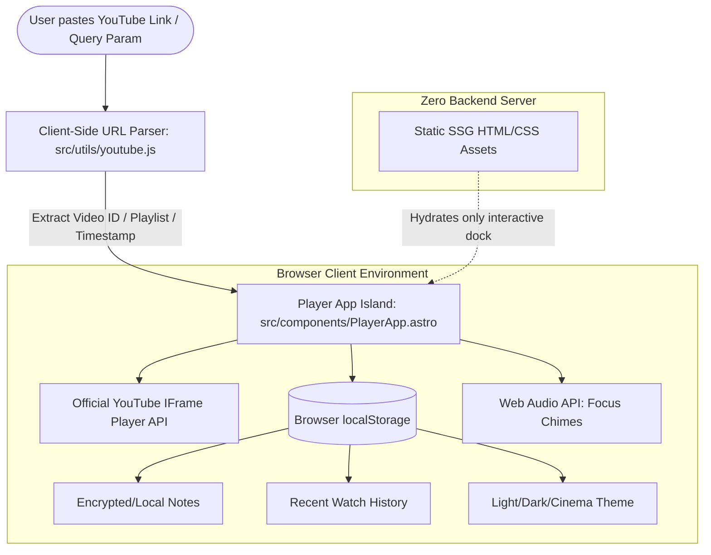

<div align="center">

# TubeCalm

**Watch what you intended. Nothing more.**  
A minimalist, distraction-free YouTube utility designed to restore deep focus, eliminate algorithmic rabbit holes, and protect user privacy.

[](https://astro.build)
[](https://tailwindcss.com)
[](https://tubecalm.com/privacy)
[](LICENSE)

[Live Demo](https://tubecalm.com) · [Report Bug](https://github.com/your-username/tubecalm/issues) · [Request Feature](https://github.com/your-username/tubecalm/issues)

</div>

---

## 📖 Overview

YouTube is the world's greatest open repository of lectures, tutorials, documentary cinema, and music. However, it is fundamentally engineered as an attention-extraction engine. Algorithmic home feeds, thumbnail clickbait, toxic comment sections, related video sidebars, and infinite Shorts feeds are designed to prolong session duration rather than serve the viewer's original intent.

**TubeCalm** (`tubecalm.com`) strips away platform clutter. Users paste any YouTube video or playlist link and watch it in a stark, focused embedded environment powered directly by the official YouTube IFrame Player API.

- **Zero Algorithmic Interventions:** No suggested videos, no up-next queues, no comment walls, and no home feeds.
- **Universal URL Parsing:** Supports standard links, shortened URLs, YouTube Shorts, full playlists, live streams, and timestamp parameters.
- **100% Client-Side Privacy:** No database, no backend server, no tracking pixels, and no mandatory accounts.

---

## ✨ Features

### 🎬 Distraction-Free Playback
- **Official YouTube IFrame Player API:** Ensures high fidelity, original resolutions, creator attribution, and caption compliance without UI bloat.
- **Shorts Auto-Conversion:** Converts vertical, infinite-swipe YouTube Shorts into standard 16:9 landscape video with scrubbers and playback controls.
- **Full Playlist Navigation:** Seamlessly browse and play entire playlists or video-in-playlist targets.
- **Timestamp Precision:** Automatically parses timestamps (`?t=1m30s`, `?t=90`, `#t=120s`) and jumps straight to the exact second.
- **Theater Mode (`t`):** Expands the player container for an immersive viewing experience.
- **Cinema Ambient Dimmer (`c`):** Plunges the entire page into pure black (`#000000`) with a subtle atmospheric backlight glow.
- **Video Looping:** Toggle seamless looping for study music, white noise, or coding ambient streams.
- **Granular Speed Control:** Switch between `0.5×`, `0.75×`, `1.0×`, `1.25×`, `1.5×`, `1.75×`, and `2.0×`.

### 🧠 Deep Work & Study Companion
- **Pomodoro / Focus Session Timer:** Integrated timer with presets (15m, 25m, 45m, 60m) and gentle two-tone harmonic audio chimes synthesized directly through the Web Audio API.
- **Timestamped Video Notes:** Take notes in real time. Click **"Insert Timestamp"** to inject marks like `[04:15]`, which automatically turn into clickable links that seek the video.
- **One-Click Shareable Clean Links:** Share clean `tubecalm.com/?v=VIDEO_ID` URLs with students, colleagues, or study groups.

### 🔒 Privacy by Architecture
- **Zero Remote Storage:** Watch history and study notes are stored strictly in the user's browser `localStorage`.
- **Instant Data Purge:** One-click button in the History tab and Privacy page to completely wipe all cached local storage.
- **Zero Tracking:** No Google Analytics, no Facebook Pixel, no ad trackers, and no third-party cookies.

---

## ⚔️ Competitor Comparison

| Dimension | [Unhook.app](https://unhook.app) | [Purify.video](https://purify.video) | [NoSuggest.com](https://nosuggest.com) | **TubeCalm** |
|:---|:---:|:---:|:---:|:---:|
| **Platform** | Browser Extension | Legacy Web Utility | PWA / RSS Reader | **Universal Web Utility** |
| **Device Compatibility** | Desktop Chrome/Firefox/Edge | Web | Web / Mobile | **Any device (Phone, Tablet, Desktop, TV)** |
| **Installation** | Requires extension & permissions | None | None | **Zero install, zero friction** |
| **Shorts Handling** | Hides shorts completely | Often breaks | Hides shorts | **Auto-converts Shorts into landscape player** |
| **Playlist Support** | Native YouTube page | Unreliable | Channel feeds | **Full playlist playback + cueing** |
| **Study Tools** | None | None | None | **Pomodoro Timer + Clickable Timestamp Notes** |
| **Account Required** | No | Frequently gates | No | **100% Anonymous** |
| **User Privacy** | Local extension | Ad trackers present | Local storage | **100% Client-side, zero tracking** |

---

## 🏗️ Architecture

TubeCalm leverages Astro's **Islands Architecture** to minimize client-side JavaScript overhead:



### Architecture Highlights:
1. **Static Site Generation (SSG):** All marketing, informational, FAQ, and privacy pages compile to zero-JS static HTML at build time.
2. **Selective Hydration:** Client-side JavaScript is restricted exclusively to the `PlayerApp` island where player controls, timers, and storage operations execute.
3. **Zero-Latency Embed:** Loads the official `https://www.youtube.com/iframe_api` asynchronously, reducing Initial Server Response Time and optimizing Largest Contentful Paint (LCP).

---

## 🛠️ Tech Stack

- **Framework:** [Astro v7+](https://astro.build) (Static Site Generation & Island Architecture)
- **Styling:** [Tailwind CSS v4](https://tailwindcss.com) with `@tailwindcss/vite`
- **Design System:** Geist Design Language (monochrome ink `#171717`, `#fafafa` canvas, `#ebebeb` hairlines, tightly tracked Geist Sans display type, Geist Mono eyebrows)
- **Player API:** Official YouTube IFrame Player API
- **Audio Synthesizer:** Native Web Audio API (`AudioContext`, sine wave oscillator for non-intrusive focus chimes)
- **Icons & Graphics:** Inline SVG icons & vector illustrations
- **Deployment Target:** Static hosting (Vercel, Cloudflare Pages, Netlify, or GitHub Pages)

---

## 📁 Project Structure

```text
Ai-Project-1/
├── public/
│   ├── favicon.ico             # Legacy browser icon
│   └── favicon.svg             # Minimalist SVG wordmark icon
├── src/
│   ├── components/
│   │   ├── ComparisonSection.astro  # Competitor matrix (Unhook, Purify, NoSuggest)
│   │   ├── FaqAccordion.astro       # Accessible question & answer accordion
│   │   ├── FeaturesGrid.astro       # 4-card hairline grid of core capabilities
│   │   ├── Footer.astro             # Geist-styled footer with privacy badges
│   │   ├── Header.astro             # Top navigation with theme toggle & shortcuts
│   │   ├── HeroSection.astro        # Hero banner with multi-stop mesh gradient
│   │   └── PlayerApp.astro          # Core player, controls, timer, notes & history
│   ├── layouts/
│   │   └── Layout.astro             # Base HTML shell, SEO, OpenGraph, JSON-LD schema
│   ├── pages/
│   │   ├── about.astro              # Mission manifesto and attention economy analysis
│   │   ├── faq.astro                # Comprehensive FAQ and keyboard shortcut guide
│   │   ├── index.astro              # Landing page and interactive player
│   │   └── privacy.astro            # Transparent privacy policy & 1-click data purge
│   ├── styles/
│   │   └── global.css               # Tailwind CSS v4 entrypoint, @theme tokens & mesh
│   └── utils/
│       └── youtube.js               # Robust YouTube URL, Shorts, and timestamp parser
├── astro.config.mjs                 # Astro configuration with Tailwind Vite plugin
├── DESIGN.md                        # Master Geist design tokens and design guidelines
├── package.json                     # Project manifest and scripts
└── tsconfig.json                    # TypeScript compiler configuration
```

---

## ⌨️ Keyboard Shortcuts

| Shortcut | Action |
|:---:|:---|
| <kbd>Space</kbd> or <kbd>k</kbd> | Toggle Play / Pause |
| <kbd>←</kbd> or <kbd>j</kbd> | Seek backward 10 seconds |
| <kbd>→</kbd> or <kbd>l</kbd> | Seek forward 10 seconds |
| <kbd>m</kbd> | Toggle Mute / Unmute |
| <kbd>t</kbd> | Toggle Theater Mode |
| <kbd>c</kbd> | Toggle Cinema Ambient Dimmer |
| <kbd>f</kbd> | Toggle Fullscreen |
| <kbd>?</kbd> | Open Keyboard Shortcuts Cheat-sheet |

*(Shortcuts are automatically suppressed when typing inside note fields or URL inputs).*

---

## 🚀 Getting Started

### Prerequisites
- **Node.js:** `>= 22.0.0`
- **Package Manager:** `npm` (or `pnpm` / `bun`)

### Installation

1. **Clone the repository:**
   ```bash
   git clone https://github.com/your-username/tubecalm.git
   cd tubecalm
   ```

2. **Install dependencies:**
   ```bash
   npm install
   ```

3. **Start the local development server:**
   ```bash
   npm run dev
   ```
   Or launch in Astro's background mode:
   ```bash
   npx astro dev --background
   ```

4. **Open in your browser:**  
   Navigate to [http://localhost:4321](http://localhost:4321).

### Build & Production Preview

```bash
# Compile static production build to ./dist/
npm run build

# Preview production build locally
npm run preview
```

---

## 🔮 Future Scopes & Roadmap

- [ ] **Phase 2 — Official Companion Chrome / Firefox Extension:**
  - One-click button on `youtube.com` to immediately bounce the active tab into `tubecalm.com/?v=...`.
  - Context menu integration: Right-click any YouTube video link → *"Open in TubeCalm"*.
- [ ] **Offline PWA Manifest:** Enable Progressive Web App installability for desktop and mobile home screens.
- [ ] **Data Export & Import:** Export timestamped study notes and watch bookmarks as standard Markdown (`.md`) or JSON files.
- [ ] **Custom Ambient Sound Generator:** Optional layered background white noise (binaural beats, soft rain, coffee shop murmur) to pair with silent lectures.
- [ ] **Chapter Navigation Extraction:** Native chapter marks along the custom timeline scrubber.

---

## 🛡️ Privacy & Ethical Commitment

TubeCalm operates on a strict **zero-telemetry** policy:
- We do not run server-side trackers, analytics agents, or user databases.
- We do not intercept or log URLs pasted by users.
- Embedded video playback adheres strictly to Google's official YouTube IFrame Player Terms of Service. Creators continue to receive legitimate view counts and metrics.

---

## 📄 License

Distributed under the **MIT License**. See `LICENSE` for more information.

---

<div align="center">
Built with intent. Made for deep work and distraction-free learning.
</div>
